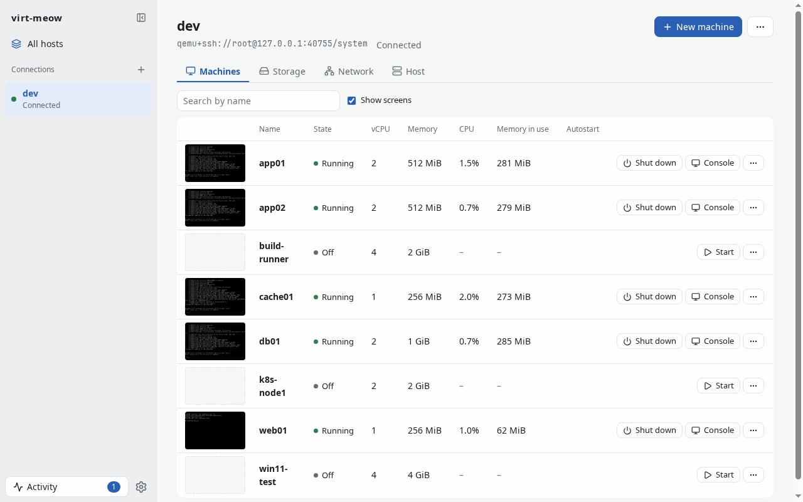
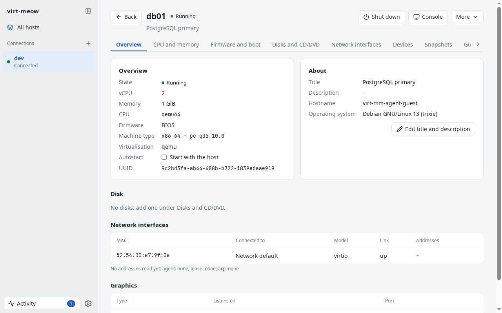
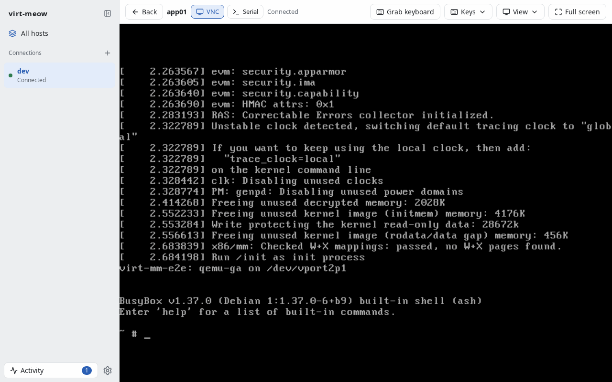

<p align="center">
  
</p>

**virt-meow** — virt-manager, minus the typing. The command is `virt-mm`.

[简体中文](README.zh-CN.md)

A libvirt virtual machine manager for the machines on this computer or on
others over SSH: a desktop window, a command line and a web page, one core
in pure Go.



## Status

**Alpha.** Every capability is tested against libvirtd and QEMU in a
container, little yet on real hosts. Expect rough edges, and read
[ROADMAP.md](ROADMAP.md) for what is still missing to replace virt-manager.

## Features

- **Connections** to `qemu:///system`, `qemu:///session` and
  `qemu+ssh://user@host/system`, several at once, kept alive and
  reconnected on their own.
- **SSH in process**: the agent, your keys and `~/.ssh/config`, a password
  asked in a dialog. An unknown host key is shown with its fingerprint and
  trusted only on your word; a changed one is refused.
- **Machines**, kept current by libvirt's events: power actions, CPU,
  memory and disk graphs, snapshots, clone, rename, delete.
- **New machines** from an ISO, a cloud image or an existing disk, with
  osinfo-db's recommendations, cloud-init, BIOS / UEFI / Secure Boot and a TPM.
- **Hardware**: disks (hot-plugged when running), CD/DVD media, network
  interfaces, boot order, host PCI/USB devices, shared folders, and the XML
  definition, validated by libvirt before it is saved.
- **Consoles**: VNC and SPICE in the window or browser, the serial console,
  and `virt-mm vnc|spice` to forward one to any viewer.
- **Storage and networks**: pools and volumes (uploads included), NAT,
  routed, isolated and bridged networks.
- **The command line**, `virt-mm`, does all of the above, every command
  with `--json`.
- **In a browser**: `virt-mm serve` shows the same pages, behind a login,
  over HTTPS if you give it a certificate.

virt-meow is the name you read; `virt-mm` is what you type, as with Visual
Studio Code and `code` ([ADR-0004](docs/adr/0004-name.md)).

| | |
|---|---|
|  |  |

## Install

Every [release](https://github.com/jing2uo/virt-meow/releases/latest) has
two kinds of files, named the same in every version:

| | Linux | macOS | Windows |
|---|---|---|---|
| **virt-meow**, the app: its window, and the command line in the same binary | `virt-meow-linux-x86_64`<br>`virt-meow-linux-arm64` | `virt-meow-macos.zip` | `virt-meow-windows-x86_64.zip`<br>`virt-meow-windows-arm64.zip` |
| **virt-mm**, the command line alone: static, no window | `virt-mm-linux-x86_64.tar.gz`<br>`virt-mm-linux-arm64.tar.gz` | `virt-mm-macos-x86_64.tar.gz`<br>`virt-mm-macos-arm64.tar.gz` | `virt-mm-windows-x86_64.zip`<br>`virt-mm-windows-arm64.zip` |

and `SHA256SUMS`. The app's binary is `virt-mm` too: with no command it
opens the window, `virt-mm ls` lists machines.

### Linux

[](https://flatpark.org/apps/io.github.jing2uo.VirtMeow/)

```sh
flatpak remote-add --if-not-exists --user flatpark https://dl.flatpark.org/flatpark.flatpakrepo
flatpak install --user flatpark io.github.jing2uo.VirtMeow
```

Or download `virt-meow-linux-x86_64` or `virt-meow-linux-arm64`, a single
binary, and make it executable (and call it `virt-mm`). It needs GTK 4, WebKitGTK 6 and glibc 2.38
or later on the system, so a recent distribution (Debian 13, Ubuntu 24.04,
Fedora 40); it is built for, and tested in, the Flatpak's GNOME 51 runtime.

### macOS (experimental)

Download `virt-meow-macos.zip` (Apple silicon and Intel, macOS 12 or later)
and move `virt-meow.app` to Applications. It is not signed with a developer
ID nor notarized, so macOS refuses to open it at first: right-click it,
choose **Open**, then **Open** again; or clear the quarantine:

```sh
xattr -dr com.apple.quarantine /Applications/virt-meow.app
```

The command line is `/Applications/virt-meow.app/Contents/MacOS/virt-mm`.

### Windows (experimental)

Download `virt-meow-windows-x86_64.zip` (or `-arm64`) and run `virt-mm.exe`.
The window needs the WebView2 runtime, which Windows 11 has (on Windows 10,
install it from Microsoft). The exe isn't signed, so SmartScreen may say
"Windows protected your PC": **More info** → **Run anyway**.

`virt-mm.exe ls` and the other commands print to the terminal they are run
in, but as a windowed program it doesn't make the terminal wait: the prompt
can come back before the output (`virt-mm ls | more` waits). For scripts and
commands that ask questions (`hostkey trust`, passwords), use the
`virt-mm.exe` of `virt-mm-windows-*.zip`, a console program.

### The command line alone

`virt-mm-<os>-<arch>.tar.gz` (Windows: `.zip`) for Linux, macOS and
Windows on x86_64 and arm64: static, no window; put `virt-mm` on your
`PATH`. With Go:

```sh
go install -tags nogui github.com/jing2uo/virt-meow/cmd/virt-mm@latest
```

### From source

Go (the version in `go.mod`), make; podman for the Linux GUI and the e2e
tests; `flatpak` and `org.flatpak.Builder` for the local Flatpak.

```sh
make cli       # dist/virt-mm-cli: static, no GUI, any platform (CGO_ENABLED=0)
make image     # once: the container the Linux GUI is built in
make gui       # dist/virt-mm: the GUI for Linux (GTK 4, WebKitGTK 6)
make flatpak   # build and install a local Flatpak of it, to run while developing
make windows   # the Windows GUI, cross-compiled (no cgo needed)
make gui-native  # the GUI with this host's toolchain (on a Mac: Xcode's clang)
make dist      # the CLI release archives in dist/release
```

## Platforms

| | Linux | macOS | Windows |
|---|---|---|---|
| Desktop window | yes (FlatPark, or the binary) | experimental, unsigned | experimental, unsigned |
| `virt-mm` CLI | yes | yes | yes |
| `virt-mm serve` (any browser) | yes | yes | yes |

The hosts it manages run libvirt (Linux); virt-meow reaches them over SSH
from any of these. On macOS and Windows the window is new: remembered
passwords and the console's native keyboard grab are Linux-only so far
([ROADMAP.md](ROADMAP.md)).

## Quick start

```sh
virt-mm conn add qemu+ssh://root@kvm1/system --name kvm1 --autoconnect
virt-mm hostkey trust kvm1     # first contact: check the fingerprint, then trust
virt-mm ls -c kvm1
virt-mm upload ~/Downloads/debian-13-netinst.iso default -c kvm1
virt-mm create web01 -c kvm1 --disk default:40G --iso default/debian-13-netinst.iso \
    --net bridge:br0 --start
virt-mm console web01 -c kvm1  # serial console; Ctrl+] leaves
virt-mm serve                  # the pages at http://127.0.0.1:8080/
```

Without `-c`: `$VIRT_MM_URI`, else the only saved connection, else
`qemu:///system`. Settings live in `$VIRT_MM_CONFIG`, or `virt-mm/` in the
user's config directory. `virt-mm help` lists every command.

`virt-mm serve` listens on loopback without a password; beyond loopback it
needs one (`virt-mm serve --set-password`, or `--password-file`), and
`--tls-cert`/`--tls-key` serve HTTPS.

## Documentation

- [docs/adr/](docs/adr/): the design decisions, starting with the
  [architecture](docs/adr/0001-architecture.md) and
  [connections and SSH](docs/adr/0002-connections-and-ssh.md)
- [docs/spec/](docs/spec/): [milestones](docs/spec/p0.md) and the
  [CLI against virsh](docs/spec/virsh.md)
- [ROADMAP.md](ROADMAP.md): what is missing

## Contributing

See [CONTRIBUTING.md](CONTRIBUTING.md). Security issues: see
[SECURITY.md](SECURITY.md), not the public issue tracker.

## License

[MIT](LICENSE), Copyright (c) 2026 Komh.

virt-meow ships third-party components under their own licenses:

| Component | Use | License |
|---|---|---|
| [osinfo-db](https://gitlab.com/libosinfo/osinfo-db) | operating system data, when a host has none | GPL-2.0-or-later |
| [noVNC](https://github.com/novnc/noVNC) | the VNC console | MPL-2.0 |
| [spice-html5](https://gitlab.freedesktop.org/spice/spice-html5) | the SPICE console | LGPL-3.0 |
| [xterm.js](https://github.com/xtermjs/xterm.js) | the serial console | MIT |
| [Lucide](https://lucide.dev) | icons | ISC |

Details, versions and license files: [internal/ui/assets/vendor/README.md](internal/ui/assets/vendor/README.md)
and [internal/hv/osinfo-db/README.md](internal/hv/osinfo-db/README.md).
