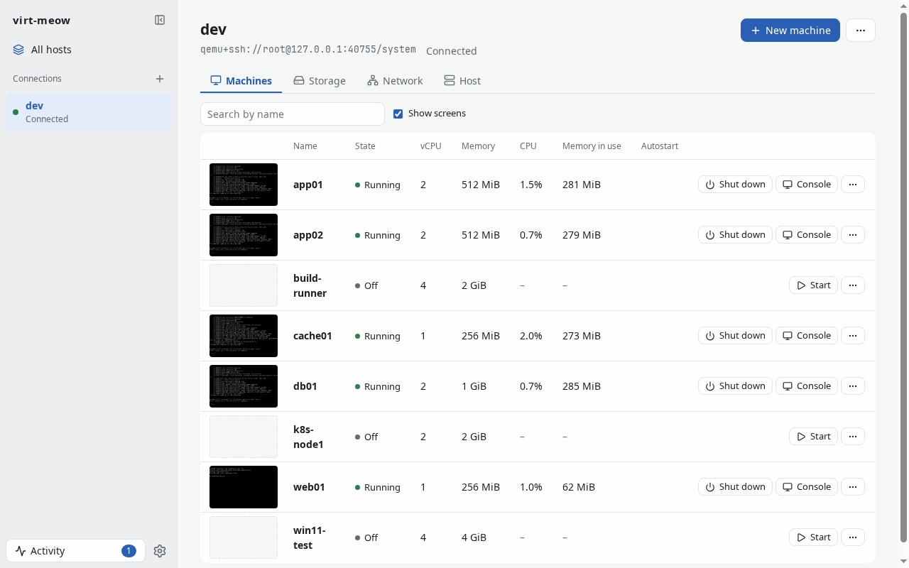
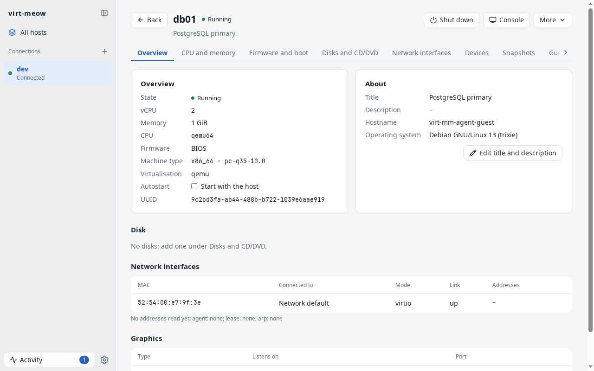
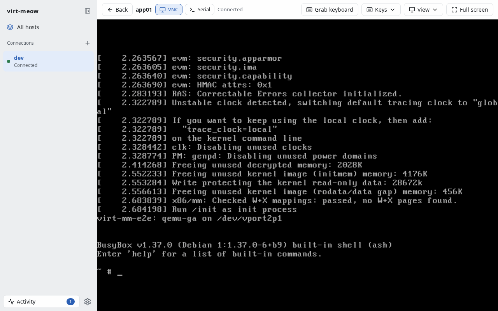

**virt-meow** — virt-manager, minus the typing. The command is `virt-mm`.

[English](README.md)

libvirt 虚拟机管理器, 管理本机或经 SSH 管理其它主机上的虚拟机:
桌面窗口、命令行和网页, 共用一个纯 Go 的核心。



## 状态

**Alpha。** 每项功能都在容器里的 libvirtd 和 QEMU 上测过, 在真实主机上用得还少。
会有粗糙之处; 要替代 virt-manager 还缺什么, 见 [ROADMAP.md](ROADMAP.md) (英文)。

## 功能

- **连接** `qemu:///system`、`qemu:///session` 和 `qemu+ssh://user@host/system`,
  可同时连多个, 自动保活和重连。
- **进程内 SSH**: ssh-agent、你的密钥和 `~/.ssh/config`, 密码在对话框里问。
  未知的 host key 显示指纹, 你确认后才信任; 变了的一律拒绝。
- **机器**, 随 libvirt 事件实时更新: 电源操作, CPU、内存和磁盘图表,
  快照、克隆、改名、删除。
- **新建机器**: 从 ISO、云镜像或已有磁盘, 带 osinfo-db 的推荐配置、cloud-init、
  BIOS / UEFI / 安全启动和 TPM。
- **硬件**: 磁盘 (运行中热插拔)、光盘、网卡、启动顺序、主机 PCI/USB 设备、共享文件夹,
  以及 XML 定义 (保存前由 libvirt 校验)。
- **控制台**: 窗口或浏览器里的 VNC 和 SPICE、串口控制台, 以及用
  `virt-mm vnc|spice` 转发给任意客户端。
- **存储和网络**: 存储池和卷 (含上传), NAT、路由、隔离和桥接网络。
- **命令行** `virt-mm` 能做以上全部, 每个命令都支持 `--json`。
- **浏览器**: `virt-mm serve` 提供同样的页面, 可加登录, 给了证书就走 HTTPS。

virt-meow 是给人看的名字, `virt-mm` 是敲的命令, 就像 Visual Studio Code 和
`code` ([ADR-0004](docs/adr/0004-name.md))。两者都念"喵喵", 所以 logo 是只猫。

| | |
|---|---|
|  |  |

## 安装

每个 [release](https://github.com/jing2uo/virt-meow/releases/latest) 都有 Linux、macOS、Windows
的窗口版、命令行二进制和 `SHA256SUMS`。窗口版的二进制同时也是命令行: 不带命令的 `virt-mm`
打开窗口, `virt-mm ls` 列出机器。

### Linux

[](https://flatpark.org/apps/io.github.jing2uo.VirtMeow/)

```sh
flatpak remote-add --if-not-exists --user flatpark https://dl.flatpark.org/flatpark.flatpakrepo
flatpak install --user flatpark io.github.jing2uo.VirtMeow
```

也可以直接下载单文件的 `virt-mm-linux-x86_64` 或 `virt-mm-linux-aarch64`, 加上可执行权限即可。
它需要系统里有 GTK 4、WebKitGTK 6 和 glibc 2.38 以上, 也就是较新的发行版 (Debian 13、
Ubuntu 24.04、Fedora 40); 它是按 Flatpak 的 GNOME 51 运行时构建和测试的。

### macOS (实验性)

下载 `virt-meow-macos.zip` (Apple 芯片和 Intel 通用, macOS 12 及以上), 把 `virt-meow.app`
拖进"应用程序"。它没有用开发者 ID 签名, 也没有公证, 所以第一次 macOS 会拒绝打开:
右键点它, 选"打开", 再点"打开"; 或者去掉隔离标记:

```sh
xattr -dr com.apple.quarantine /Applications/virt-meow.app
```

命令行是 `/Applications/virt-meow.app/Contents/MacOS/virt-mm`。

### Windows (实验性)

下载 `virt-mm-windows-amd64.zip` (或 `-arm64`), 运行 `virt-mm.exe`。窗口需要 WebView2
运行时, Windows 11 自带 (Windows 10 可从微软下载安装)。exe 没有签名, SmartScreen 可能提示
"Windows 已保护你的电脑": 点"更多信息" → "仍要运行"。

`virt-mm.exe ls` 等命令会输出到运行它的终端, 但因为它是窗口程序, 终端不会等它结束:
提示符可能先于输出出现 (`virt-mm ls | more` 会等)。写脚本或要回答问题的命令
(`hostkey trust`、密码), 请用 CLI 归档里的 `virt-mm.exe`, 那是控制台程序。

### 只要命令行

Linux、macOS、Windows 的 amd64 和 arm64 版 `virt-mm_<版本>_<os>_<arch>.tar.gz`
(Windows 为 `.zip`): 静态链接、不含 GUI, 把 `virt-mm` 放进 `PATH` 即可。用 Go 安装:

```sh
go install -tags nogui github.com/jing2uo/virt-meow/cmd/virt-mm@latest
```

### 从源码构建

需要 Go (版本见 `go.mod`)、make; Linux GUI 和 e2e 测试要 podman;
本地 Flatpak 要 `flatpak` 和 `org.flatpak.Builder`。

```sh
make cli       # dist/virt-mm-cli: 静态、无 GUI、任意平台 (CGO_ENABLED=0)
make image     # 一次即可: 构建 Linux GUI 用的容器
make gui       # dist/virt-mm: Linux GUI (GTK 4, WebKitGTK 6)
make flatpak   # 构建并安装本地 Flatpak, 开发时运行 GUI 用
make windows   # Windows GUI, 交叉编译 (不需要 cgo)
make gui-native  # 用本机工具链构建 GUI (Mac 上用 Xcode 的 clang)
make dist      # CLI 发布归档, 在 dist/release
```

## 平台

| | Linux | macOS | Windows |
|---|---|---|---|
| 桌面窗口 | 支持 (FlatPark 或二进制) | 实验性, 未签名 | 实验性, 未签名 |
| `virt-mm` 命令行 | 支持 | 支持 | 支持 |
| `virt-mm serve` (任意浏览器) | 支持 | 支持 | 支持 |

被管理的主机跑 libvirt (Linux); virt-meow 可从以上任一平台经 SSH 连过去。macOS 和 Windows
的窗口版是新加的: 记住密码 (钥匙串) 和控制台的原生键盘抓取目前只在 Linux 上有
([ROADMAP.md](ROADMAP.md))。

## 快速上手

```sh
virt-mm conn add qemu+ssh://root@kvm1/system --name kvm1 --autoconnect
virt-mm hostkey trust kvm1     # 首次连接: 核对指纹后信任
virt-mm ls -c kvm1
virt-mm upload ~/Downloads/debian-13-netinst.iso default -c kvm1
virt-mm create web01 -c kvm1 --disk default:40G --iso default/debian-13-netinst.iso \
    --net bridge:br0 --start
virt-mm console web01 -c kvm1  # 串口控制台; Ctrl+] 退出
virt-mm serve                  # 页面在 http://127.0.0.1:8080/
```

不带 `-c` 时: 用 `$VIRT_MM_URI`, 否则唯一保存的连接, 否则 `qemu:///system`。
设置保存在 `$VIRT_MM_CONFIG`, 或用户配置目录下的 `virt-mm/`。`virt-mm help` 列出所有命令。

`virt-mm serve` 默认只听本机回环、不要密码; 要对外监听必须设密码
(`virt-mm serve --set-password` 或 `--password-file`), `--tls-cert`/`--tls-key` 启用 HTTPS。

## 文档

- [docs/adr/](docs/adr/): 设计决策, 先看[架构](docs/adr/0001-architecture.md)和
  [连接与 SSH](docs/adr/0002-connections-and-ssh.md)
- [docs/spec/](docs/spec/): [里程碑](docs/spec/p0.md)和
  [CLI 与 virsh 对照](docs/spec/virsh.md)
- [ROADMAP.md](ROADMAP.md): 还缺什么

(文档为英文。)

## 参与贡献

见 [CONTRIBUTING.md](CONTRIBUTING.md)。安全问题请按 [SECURITY.md](SECURITY.md)
私下报告, 不要发公开 issue。

## 许可证

[MIT](LICENSE), Copyright (c) 2026 Komh。

virt-meow 附带的第三方组件各自沿用其许可证:

| 组件 | 用途 | 许可证 |
|---|---|---|
| [osinfo-db](https://gitlab.com/libosinfo/osinfo-db) | 主机没有时使用的操作系统数据 | GPL-2.0-or-later |
| [noVNC](https://github.com/novnc/noVNC) | VNC 控制台 | MPL-2.0 |
| [spice-html5](https://gitlab.freedesktop.org/spice/spice-html5) | SPICE 控制台 | LGPL-3.0 |
| [xterm.js](https://github.com/xtermjs/xterm.js) | 串口控制台 | MIT |
| [Lucide](https://lucide.dev) | 图标 | ISC |

详情、版本和许可证文件: [internal/ui/assets/vendor/README.md](internal/ui/assets/vendor/README.md)
和 [internal/hv/osinfo-db/README.md](internal/hv/osinfo-db/README.md)。
